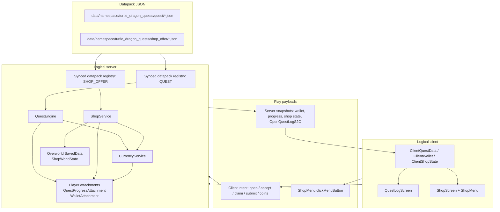
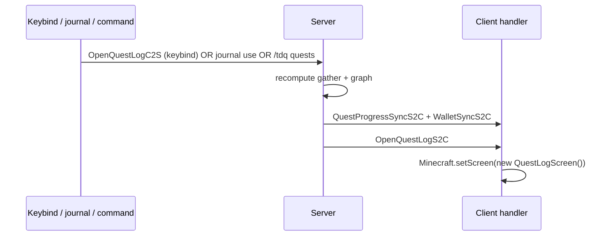
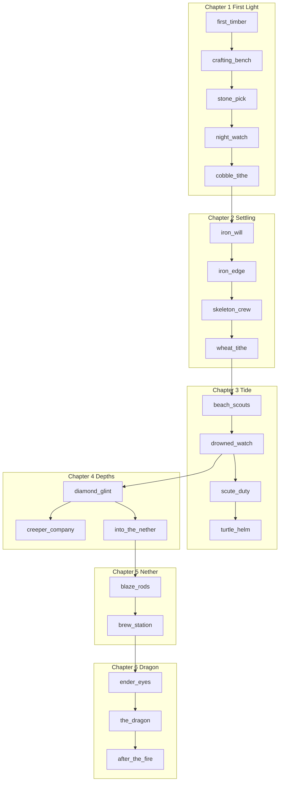
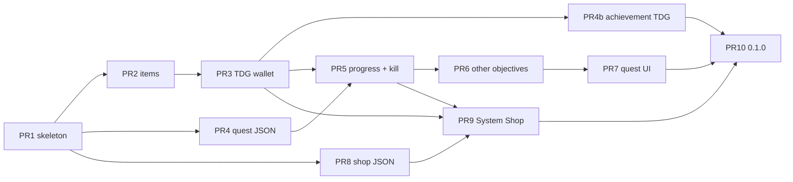

# Turtle Dragon Quests — Milestone 1 Design

| Field | Value |
| --- | --- |
| **Document** | System quests + System Shop + TDG Coin (v1) |
| **Mod** | Turtle Dragon Quests |
| **Mod ID** | `turtle_dragon_quests` |
| **Package** | `com.jbarnes.turtledragonquests` |
| **Working directory** | `/home/jbarnes/projects/MInecraft_Turtle_Dragon_Quests` |
| **Target** | Minecraft 1.21.1, NeoForge 21.1.x |
| **Author** | TBD |
| **Date** | 2026-10-12 |
| **Status** | Draft (revised after review `f309b810`; TDG Coin / System Shop locked) |
| **Design ID** | `f309b810` |
| **License** | **LGPL-3.0-only** (SPDX) |

---

## Overview

Turtle Dragon Quests is a greenfield **NeoForge 1.21.1** Java mod. Milestone 1 ships a **System Shop** economy whose only currency is **TDG Coin**:

1. **System quests** (JSON datapack registry): named quests, typed objectives (gather, kill, visit, craft, submit), per-player progress. Claiming a completed system quest grants **TDG Coin** and may also grant **special rewards** (items, quest unlocks).
2. **System Shop** (server-wide catalog, not villager trades): every buy and sell offer is priced in **TDG Coin**.
3. **Achievements**: completing mapped vanilla advancements grants **TDG Coin** once (datapack table, not a second achievement UI).

The source of truth for TDG and quest progress lives on the **logical server** (player `AttachmentType` + overworld `SavedData`). Clients render synced snapshots and send intent packets (`claim`, `submit`, `open`); they never decide completion or balances. Shop buy/sell go through `ShopMenu.clickMenuButton`, not a second C2S price channel. Persistence survives logout, dimension change, death (`copyOnDeath`), and process restart.

This document freezes the JSON/codec contract, payload records, shop stock semantics, and screen-open protocol so an engineer can implement without inventing APIs.

---

## Background & Motivation

The repo at `/home/jbarnes/projects/MInecraft_Turtle_Dragon_Quests` is empty. There is an unrelated Fabric 1.21.11 example at `/home/jbarnes/projects/bigger-chickens` (Java 25 toolchain, Fabric Loom, MC 1.21.11). **Do not copy its loader, Gradle plugin, mappings, or version pins.** Glance at it only for the user's general "Java Minecraft mod in `com.jbarnes.*`" layout.

Vanilla Minecraft has advancements (progress, but not a shop or a first-class currency) and villager trades (per-entity, not a global catalog). Existing quest mods (FTB Quests, Better Questing) are out of scope as dependencies. This milestone needs a small, owned stack:

- JSON that pack makers can override with datapacks and `/reload`.
- One economy: **TDG Coin**, earned from system quests and mapped achievements, spent in the System Shop.
- Dedicated-server and integrated-singleplayer parity.
- No client-trusted completion or purchase.

Pain if we skip a design pass: mixing Fabric assumptions, putting balances in client NBT, using scoreboards as the economy, or baking quests into Java instead of datapacks — all of which are expensive to unwind on 1.21.1 NeoForge.

---

## Goals & Non-Goals

### Goals (milestone 1)

- Buildable NeoForge 1.21.1 mod. CI / PR 1 gate is **`./gradlew build` only**. `runClient` / `runServer` / `runData` are local tools. `runGameTestServer` is a gate only after GameTests exist (PR 3+); the MDK crashes that run when the namespace is enabled with zero tests.
- Data-driven **system quests** with the five objective types below. Claim pays **TDG Coin** plus optional special item/unlock rewards.
- Data-driven **System Shop** (buy and sell), priced only in TDG Coin.
- **TDG Coin** wallet with persistence, physical `tdg_coin` item, and admin commands.
- **Achievement TDG**: datapack map from vanilla advancement id → TDG, paid once per player.
- Player UI for quest log and System Shop.
- Server-authoritative networking; anti-dup for currency mutations and shop transactions.
- Admin reload of datapack content: vanilla `/reload` **and** `/tdq reload` both run the same post-reload fan-out (recompute graphs, sync all players, close stale shop menus).
- Example datapack JSON: the **six-chapter system campaign** below (early → dragon), which also covers all five objective types; System Shop offers gated per chapter.
- GameTests listed in Testing (currency, kill, gather/submit/claim rollback, shop buy/sell/stock/menu-closed).

### Non-goals (explicit)

- Custom dimensions, structures, or worldgen.
- Custom living entities (no turtles, dragons, or NPCs as mobs).
- Custom shop **block** with a unique baked model (v1 opens System Shop via command, keybind, and item).
- Custom achievement UI (v1 pays TDG for vanilla advancements only).
- FTB Quests / Heracles / Better Questing compatibility.
- Vault, Economy, or other plugin-bridge currency adapters.
- Cross-mod capability currency (no `ICurrency` SPI in v1). A later adapter can call `CurrencyService.get(player)`.
- JEI/EMI integration.
- Quest parties, guilds, daily/weekly rotating boards.
- **Repeatable quests / cooldowns** (no JSON fields in v1; adding them later is a codec-optional bump).
- Objective **OR-groups** (AND only).
- Player-to-player auction house.
- Mixins, unless a blocker appears (none expected for this slice).
- Porting to Fabric, Forge, or Minecraft versions other than 1.21.1.
- Feature flags `enable_shop` / `enable_quests` (always on in v1).
- `coins_drop_on_death` (wallet always `copyOnDeath` in v1).

---

## Version pins (assumptions)

Verified against the official `NeoForgeMDKs/MDK-1.21.1-ModDevGradle` template and current 1.21.1 line (2026-10-11):

| Property | Pin | Notes |
| --- | --- | --- |
| Minecraft | `1.21.1` | `minecraft_version_range=[1.21.1]` |
| NeoForge | `21.1.259` | Compile pin (MDK). Runtime toml accepts `21.1.250+`. Bump 21.1.x patch freely; do not jump to 21.2+ / 26.x. |
| Java | **21** | Mojang ships Java 21 for 1.21.1. Do **not** use Java 25 from bigger-chickens. |
| Gradle | `9.2.1` | MDK wrapper (`gradle-9.2.1-bin.zip`) |
| Plugin | `net.neoforged.moddev` **2.0.148** | **ModDevGradle**, not NeoGradle, not Fabric Loom |
| Parchment | MC `1.21.1` / mappings `2024.11.17` | Official names + parameter names |
| Loader range | `[1,)` | FML major |
| NeoForge toml range | `[21.1.250,21.2)` | Must **not** be `[21.1.250,)` — that would match 21.2+/26.x if the Minecraft pin were loosened |
| Mod version | `0.1.0` | Semver; milestone 1 is `0.1.x` |
| Network protocol | `"1"` | Extra fields added with `ByteBufCodecs.optional` / trailing-optional record codecs so `"1"` can grow without an immediate bump. Breaking field-order changes bump to `"2"`. |

**Do not use** 26.x NeoForge APIs (`SavedDataType` codec constructors from the 26.1 docs, Java 25 toolchain, `Identifier` instead of `ResourceLocation` in places that still use the latter). 1.21.1 `SavedData` is NBT `Factory` + `computeIfAbsent` on `DimensionDataStorage`.

If pins drift, treat `https://projects.neoforged.net/neoforged/neoforge` (1.21.1 / 21.1.x) as source of truth and update `gradle.properties` only.

---

## Proposed Design

### High-level architecture



### Package layout

```
com.jbarnes.turtledragonquests
├── TurtleDragonQuests.java          // @Mod, registers deferred registers + listeners
├── TDQ.java                         // MOD_ID, ResourceLocation helper, logger
├── registry/
│   ├── TDQItems.java
│   ├── TDQCreativeTabs.java
│   ├── TDQMenus.java
│   ├── TDQAttachmentTypes.java
│   └── TDQDataRegistries.java
├── currency/
│   ├── WalletAttachment.java        // tdg long + starterGranted + paidAchievements
│   ├── CurrencyService.java         // final class, static methods
│   └── AchievementReward.java       // datapack: advancement id → tdg
├── quest/
│   ├── SimpleStack.java             // {item, count} — not ItemStack.CODEC
│   ├── ItemIngredient.java          // item XOR tag
│   ├── QuestDefinition.java
│   ├── Objective.java               // Codec.dispatch + MapCodec
│   ├── Reward.java
│   ├── QuestProgressAttachment.java
│   ├── QuestStatus.java
│   └── QuestEngine.java             // final class, static methods
├── shop/
│   ├── ShopOffer.java
│   ├── ShopWorldState.java
│   ├── ShopService.java             // final class, static methods
│   └── ShopMenu.java
├── network/
│   ├── TDQNetwork.java
│   ├── c2s/*.java
│   └── s2c/*.java
├── command/
│   └── TDQCommands.java
├── event/
│   ├── QuestGameplayEvents.java
│   ├── PlayerPersistenceEvents.java
│   └── DatapackSyncEvents.java      // OnDatapackSyncEvent fan-out
├── client/
│   ├── ClientSetup.java
│   ├── ClientQuestData.java
│   ├── ClientWallet.java
│   ├── ClientShopState.java
│   ├── TDQKeyMappings.java
│   └── screen/
│       ├── QuestLogScreen.java
│       └── ShopScreen.java
└── datagen/
    ├── TDQDatapackProvider.java
    └── TDQLangProvider.java
```

Resource tree:

```
src/main/java/...
src/main/resources/assets/turtle_dragon_quests/{lang,models,textures}
src/main/templates/META-INF/neoforge.mods.toml
src/generated/resources/data/turtle_dragon_quests/turtle_dragon_quests/{quest,shop_offer,achievement_reward}/
```

**Datapack path (do not “fix”):** registry key `turtle_dragon_quests:quest` loads from `data/<namespace>/turtle_dragon_quests/quest/<path>.json`. The doubled `turtle_dragon_quests` is **datapack namespace + registry namespace**. It is **not** `data/<namespace>/quest/`. Same for `shop_offer`. Built-in files therefore live at `data/turtle_dragon_quests/turtle_dragon_quests/quest/...`.

### Mod bootstrap

`TurtleDragonQuests` is the `@Mod(TDQ.MOD_ID)` entry. Constructor:

- `DeferredRegister` onto the **mod** event bus: items, creative tabs, menus, attachment types.
- **Mod bus:** `DataPackRegistryEvent.NewRegistry`, `RegisterPayloadHandlersEvent`, `RegisterMenuScreensEvent` (client), `GatherDataEvent`, `BuildCreativeModeTabContentsEvent`, `RegisterKeyMappingsEvent` (client).
- **`NeoForge.EVENT_BUS`:** `RegisterCommandsEvent`, gameplay, `PlayerEvent.PlayerLoggedInEvent`, `PlayerEvent.Clone`, `PlayerEvent.PlayerChangedDimensionEvent`, `OnDatapackSyncEvent`, `AdvancementEvent.AdvancementEarnEvent`.

```java
public final class TDQ {
    public static final String MOD_ID = "turtle_dragon_quests";
    public static final Logger LOGGER = LogUtils.getLogger();

    public static ResourceLocation id(String path) {
        return ResourceLocation.fromNamespaceAndPath(MOD_ID, path);
    }
}
```

`neoforge.mods.toml` is generated from `src/main/templates` via ModDevGradle `generateModMetadata`. `modLoader=javafml`, `neoforge` versionRange `[21.1.250,21.2)`, `minecraft` `[1.21.1]`.

No mixins config in v1.

### Data-driven content: synced datapack registries

```java
public static final ResourceKey<Registry<QuestDefinition>> QUEST_REGISTRY =
    ResourceKey.createRegistryKey(TDQ.id("quest"));

public static final ResourceKey<Registry<ShopOffer>> SHOP_OFFER_REGISTRY =
    ResourceKey.createRegistryKey(TDQ.id("shop_offer"));

public static final ResourceKey<Registry<AchievementReward>> ACHIEVEMENT_REWARD_REGISTRY =
    ResourceKey.createRegistryKey(TDQ.id("achievement_reward"));

@SubscribeEvent // mod bus
public static void newDatapackRegistries(DataPackRegistryEvent.NewRegistry event) {
    event.dataPackRegistry(QUEST_REGISTRY, QuestDefinition.CODEC, QuestDefinition.CODEC);
    event.dataPackRegistry(SHOP_OFFER_REGISTRY, ShopOffer.CODEC, ShopOffer.CODEC);
    event.dataPackRegistry(ACHIEVEMENT_REWARD_REGISTRY, AchievementReward.CODEC, AchievementReward.CODEC);
}
```

| Registry | JSON path |
| --- | --- |
| `turtle_dragon_quests:quest` | `data/<namespace>/turtle_dragon_quests/quest/<path>.json` |
| `turtle_dragon_quests:shop_offer` | `data/<namespace>/turtle_dragon_quests/shop_offer/<path>.json` |
| `turtle_dragon_quests:achievement_reward` | `data/<namespace>/turtle_dragon_quests/achievement_reward/<path>.json` |

Built-in examples are emitted by datagen into `src/generated/resources` (MDK already adds that as a resource `srcDir`). Commit generated JSON; ignore only `.cache`.

**Why not data maps?** Data maps annotate *existing* registry objects. Quests and offers are first-class. **Why not `SimpleJsonResourceReloadListener`?** Datapack registries give `Holder<T>`, conditions, network sync, and `/reload` for free.

#### After `/reload` (mandatory fan-out)

Vanilla `/reload` and `/tdq reload` must produce the same player-visible state. Implementation:

1. `/tdq reload` (op 2) calls `server.reloadResources(server.getPackRepository().getSelectedIds())` and **does not** duplicate registry loading.
2. Subscribe to `OnDatapackSyncEvent` on `NeoForge.EVENT_BUS`. When `event.getPlayer()` is `null` (broadcast / reload), run `DatapackSyncEvents.afterReload(server)`. When it is a single joining player, run the per-player sync only.
3. `afterReload`:
   - Validate quest graph (cycle detect, dangling prereq ids → WARN, skip those edges).
   - For each `ServerPlayer`: `QuestEngine.recomputeGraph(player)` (LOCKED/AVAILABLE/auto-accept); recompute gather counters; **achievement TDG backfill**; send `QuestProgressSyncS2C` + `WalletSyncS2C` + `ShopStateSyncS2C`.
   - If `player.containerMenu instanceof ShopMenu`, `player.closeContainer()` so offer indexes cannot dangle.
4. Missing quest/offer ids stay in player NBT / SavedData; UI hides them. A pack rollback restores them.

---

### Frozen JSON / codec contract

All JSON field names are snake_case. **Do not use vanilla `ItemStack.CODEC`** (`id` / `count` / `components`) in pack-facing JSON. v1 has no item components.

#### `SimpleStack` (rewards and shop goods)

| Field | Type | Optional | Default | Notes |
| --- | --- | --- | --- | --- |
| `item` | `ResourceLocation` | no | — | Item registry id. Unknown id → datapack error. |
| `count` | `int` | yes | `1` | Inclusive `1..64`. |

JSON: `{ "item": "minecraft:iron_ingot", "count": 2 }`

```java
public record SimpleStack(ResourceLocation item, int count) {
    public static final Codec<SimpleStack> CODEC = RecordCodecBuilder.create(i -> i.group(
        ResourceLocation.CODEC.fieldOf("item").forGetter(SimpleStack::item),
        Codec.intRange(1, 64).optionalFieldOf("count", 1).forGetter(SimpleStack::count)
    ).apply(i, SimpleStack::new));

    public ItemStack toStack(HolderLookup.Provider registries) { /* resolve or throw */ }
}
```

#### `ItemIngredient` (gather / submit / craft matchers)

Exactly one of `item` or `tag`. Matching is **item id or tag only**; components ignored.

| Field | Type | Optional | Notes |
| --- | --- | --- | --- |
| `item` | `ResourceLocation` | XOR `tag` | `"item": "minecraft:oak_log"` |
| `tag` | `TagKey<Item>` | XOR `item` | **No `#`.** `"tag": "minecraft:logs"` — `TagKey.codec(Registries.ITEM)`, **not** `hashedCodec`. |

JSON examples: `{ "item": "minecraft:oak_log" }` **or** `{ "tag": "minecraft:logs" }` (never `{ "tag": "#minecraft:logs" }`).

```java
public record ItemIngredient(Optional<ResourceLocation> item, Optional<TagKey<Item>> tag) {
    public static final Codec<ItemIngredient> CODEC = RecordCodecBuilder.create(i -> i.group(
        ResourceLocation.CODEC.optionalFieldOf("item").forGetter(ItemIngredient::item),
        // No leading '#'. hashedCodec would require "#minecraft:logs" and break the table.
        TagKey.codec(Registries.ITEM).optionalFieldOf("tag").forGetter(ItemIngredient::tag)
    ).apply(i, ItemIngredient::new)).validate(ing -> {
        boolean hasItem = ing.item().isPresent();
        boolean hasTag = ing.tag().isPresent();
        return hasItem == hasTag
            ? DataResult.error(() -> "item_ingredient requires exactly one of item or tag")
            : DataResult.success(ing);
    });
}
```

Do **not** use `TagKey.hashedCodec`. If `TagKey.codec` is unavailable on 1.21.1 in a given mapping set, decode `tag` as `ResourceLocation.CODEC` and wrap `TagKey.create(Registries.ITEM, id)` — still no `#`, still XOR with `item`.

#### Objective dispatch

Closed enum + Mojang `Codec.dispatch` (there is **no** `Codec.dispatchedCodec`):

```java
public enum ObjectiveType implements StringRepresentable {
    KILL("kill", KillObjective.MAP_CODEC),
    GATHER("gather", GatherObjective.MAP_CODEC),
    SUBMIT("submit", SubmitObjective.MAP_CODEC),
    CRAFT("craft", CraftObjective.MAP_CODEC),
    VISIT("visit", VisitObjective.MAP_CODEC);

    private final String name;
    private final MapCodec<? extends Objective> codec;
    // StringRepresentable.getSerializedName() = name
    public MapCodec<? extends Objective> codec() { return codec; }
}

public static final Codec<Objective> CODEC =
    StringRepresentable.fromEnum(ObjectiveType::values)
        .dispatch("type", Objective::type, ObjectiveType::codec);
```

Common objective fields:

| Field | Type | Optional | Notes |
| --- | --- | --- | --- |
| `type` | enum string | no | `kill` / `gather` / `submit` / `craft` / `visit` |
| `id` | `string` | no | Unique **within the quest**. `[a-z0-9_]+`. Duplicates → datapack error. |
| `count` | `int` | no on kill/gather/submit/craft | `>= 1`. Visit has no count (0/1). |

**`kill`:** exactly one of `entity` (`ResourceLocation` of `EntityType`) or `entity_tag` (`TagKey.codec(Registries.ENTITY_TYPE)` — **no `#`**, e.g. `"entity_tag": "minecraft:skeletons"`). Neither or both → error. `count >= 1`.

**`gather` / `submit` / `craft`:** inline `ItemIngredient` fields (`item` xor `tag`, no `#`) plus `count >= 1`.

**`visit`:** at least one constraint: `dimension`, `biome`, `box`, or (`center` + `radius` with `radius >= 1`). Empty visit → error.

`box` is **not** vanilla `BlockBox.CODEC` (that is a 6-int array `minX,minY,minZ,maxX,maxY,maxZ`). Pack JSON is an object of two `BlockPos`es; convert in the factory:

```json
"box": { "min": [0, 64, 0], "max": [16, 80, 16] }
```

```java
public static final MapCodec<BlockBox> VISIT_BOX_CODEC = RecordCodecBuilder.mapCodec(i -> i.group(
    BlockPos.CODEC.fieldOf("min").forGetter(b -> new BlockPos(b.minX(), b.minY(), b.minZ())),
    BlockPos.CODEC.fieldOf("max").forGetter(b -> new BlockPos(b.maxX(), b.maxY(), b.maxZ()))
).apply(i, (min, max) -> new BlockBox(
    min.getX(), min.getY(), min.getZ(),
    max.getX(), max.getY(), max.getZ())));
```

`VisitObjective.MAP_CODEC` uses `VISIT_BOX_CODEC.optionalFieldOf("box")`, never `BlockBox.CODEC`. Keep the “at least one constraint” `.validate`. `center` uses `BlockPos.CODEC` (`[x,y,z]`).

#### Reward dispatch

Same `dispatch("type", ...)` pattern.

| `type` | Fields | Notes |
| --- | --- | --- |
| `item` | `item`, optional `count` (SimpleStack) | |
| `currency` | `tdg` (`long`, `>= 1`) | Credits **TDG Coin** on claim. Field name is `tdg`, not `coins`. |
| `unlock` | `quest` (`ResourceLocation`) | Makes that quest `AVAILABLE` even if prereqs unmet. Does **not** bypass shop `required_quests` and does not auto-claim anything. |

#### `QuestDefinition` codec table

| Field | Type | Optional | Default |
| --- | --- | --- | --- |
| `title` | `Component` (`ComponentSerialization.CODEC`) | no | |
| `description` | `Component` | no | |
| `icon` | `ResourceLocation` (item id) | yes | empty |
| `prerequisites` | `list<ResourceLocation>` | yes | `[]` |
| `auto_accept` | `bool` | yes | `false` |
| `group` | `string` | yes | empty |
| `objectives` | `list<Objective>` | no | must be non-empty; unique `id`s |
| `rewards` | `list<Reward>` | yes | `[]` |

**Not in v1 JSON:** `repeatable`, `repeat_cooldown_seconds`. Unknown keys fail datapack load (strict DFU).

#### `ShopOffer` codec table

| Field | Type | Optional | Default | Notes |
| --- | --- | --- | --- | --- |
| `side` | `buy` \| `sell` | no | | `buy` = player pays **TDG**, receives items. `sell` = player gives items, receives **TDG**. |
| `item` | `ResourceLocation` | no | | SimpleStack |
| `count` | `int` | yes | `1` | Items **per unit** (one transaction). `1..64`. |
| `unit_price` | `long` | no | | **TDG** per unit. `>= 0` (`0` = free sample). **`< 0` is a codec error.** |
| `global_stock` | `int` | yes | absent = unlimited | Remaining **units/transactions**, not items. `>= 1` if present. |
| `required_quests` | `list<ResourceLocation>` | yes | `[]` | All must be `CLAIMED`. `UnlockReward` does not skip this. |
| `category` | `string` | yes | empty | UI grouping |

At datapack load, also refuse offers whose `unit_price` would overflow `Math.multiplyExact(unit_price, 64)` (max units per click is 1 in v1, but keep the check for future stack buys).

PR 4 and PR 8 **must** round-trip the shipped JSON through `JsonOps.INSTANCE` with the live codec (JUnit or a GameTest helper) so examples cannot drift.

---

### Quest model

```java
public enum QuestStatus {
    LOCKED,      // prerequisites unmet
    AVAILABLE,   // can be accepted (or auto-accepted)
    ACTIVE,      // tracking objectives
    COMPLETED,   // objectives done, rewards unclaimed — latched
    CLAIMED      // terminal in v1
}

public record QuestDefinition(
    Component title,
    Component description,
    Optional<ResourceLocation> icon,
    List<ResourceLocation> prerequisites,
    boolean autoAccept,
    Optional<String> group,
    List<Objective> objectives,
    List<Reward> rewards
) {}
```

| `type` | Purpose | Progress | Completion while `ACTIVE` |
| --- | --- | --- | --- |
| `kill` | Kill N matching entities | increment; cap at N | `count >= n` (latched) |
| `gather` | **Possess** N matching items (does not consume) | live recompute `min(owned, n)` | `owned >= n` (can go backwards until latch) |
| `submit` | Turn in N matching items via UI | increment only when server consumes | `count >= n` (latched; items spent) |
| `craft` | Craft N matching outputs | increment by crafted count; cap | `count >= n` (latched) |
| `visit` | Be inside constraints | 0 or 1 | `>= 1` (latched) |

```java
public sealed interface Objective permits KillObjective, GatherObjective, SubmitObjective, CraftObjective, VisitObjective {
    ObjectiveType type();
    String id();
}

public record KillObjective(String id, Optional<ResourceLocation> entity, Optional<TagKey<EntityType<?>>> entityTag, int count) implements Objective {}
public record GatherObjective(String id, ItemIngredient items, int count) implements Objective {}
public record SubmitObjective(String id, ItemIngredient items, int count) implements Objective {}
public record CraftObjective(String id, ItemIngredient output, int count) implements Objective {}
public record VisitObjective(
    String id,
    Optional<ResourceKey<Level>> dimension,
    Optional<ResourceKey<Biome>> biome,
    Optional<BlockBox> box,          // encoded with VISIT_BOX_CODEC {min,max}, not BlockBox.CODEC
    Optional<Integer> radius,
    Optional<BlockPos> center
) implements Objective {}
```

```java
public sealed interface Reward permits ItemReward, CurrencyReward, UnlockReward {}
public record ItemReward(SimpleStack stack) implements Reward {}
public record CurrencyReward(long tdg) implements Reward {}
public record UnlockReward(ResourceLocation questId) implements Reward {}
```

Shop unlocks are **not** a reward type; offers use `required_quests`.

**Completion / gather latch (frozen):**

- While status is `ACTIVE`, gather counters are the **current** possess count (can decrease if the player dumps items).
- Transition `ACTIVE → COMPLETED` happens only when **all** objectives are true **at that evaluation**, including current possess-gather. Kill/submit/craft/visit that already reached N stay at N (they do not rewind).
- Once `COMPLETED`, gather is **not** re-opened if the player later drops the items. Claim still does not consume gather items.
- Claim (`COMPLETED → CLAIMED`) is transactional: simulate inventory inserts for all `ItemReward`s **and** currency cap; if anything fails, refuse the whole claim (no coins, no items, no `UnlockReward`). Message via `ActionResultS2C`.

---

### Quest progress (per player)

```java
public final class QuestProgressAttachment {
    public static final int SCHEMA = 1;
    private final Map<ResourceLocation, QuestProgress> quests = new HashMap<>();
    public static final Codec<QuestProgressAttachment> CODEC = ...; // field "schema"
}

public final class QuestProgress {
    QuestStatus status;
    Map<String, Integer> objectiveCounts; // objective id -> progress
    long acceptedGameTime;
    long completedGameTime;
    // no claimedGameTime — v1 has no repeatables
}
```

**Attachment registration** (NeoForge 1.21.1):

```java
public static final DeferredRegister<AttachmentType<?>> ATTACHMENTS =
    DeferredRegister.create(NeoForgeRegistries.ATTACHMENT_TYPES, TDQ.MOD_ID);

public static final Supplier<AttachmentType<QuestProgressAttachment>> QUEST_PROGRESS =
    ATTACHMENTS.register("quest_progress", () ->
        AttachmentType.builder(QuestProgressAttachment::new)
            .serialize(QuestProgressAttachment.CODEC)
            .copyOnDeath()
            .build());

public static final Supplier<AttachmentType<WalletAttachment>> WALLET =
    ATTACHMENTS.register("wallet", () ->
        AttachmentType.builder(WalletAttachment::new)
            .serialize(WalletAttachment.CODEC)
            .copyOnDeath()
            .build());
```

Access: `player.getData(...)`. Prefer `player.setData(...)` after each transaction. Do **not** use `AttachmentType.Builder.sync`.

**Login / clone / dimension:**

- `PlayerEvent.PlayerLoggedInEvent`: recompute graph + gather; **achievement TDG backfill**; send full `QuestProgressSyncS2C` + `WalletSyncS2C` + `ShopStateSyncS2C`.
- `AdvancementEvent.AdvancementEarnEvent`: pay mapped TDG once.
- `PlayerEvent.Clone`: `copyOnDeath()` copies attachments; still re-send S2C for the new client entity.
- `PlayerEvent.PlayerChangedDimensionEvent`: full sync again (cheap, covers dropped packets).

---

### Quest engine (server)

`QuestEngine` is a **final class** with static methods (not an interface, not a `BlockEntity`).

**Accept** (`AcceptQuestC2S`): status must be `AVAILABLE`; set `ACTIVE`; zero counters; immediately recompute gather.

**Kill:** `LivingDeathEvent` at **`EventPriority.LOWEST`**, `!event.isCanceled()`, `!level.isClientSide`. Attacker = `event.getSource().getEntity()` **must be** `ServerPlayer` (the damaging entity). **Pets, wolves, dispensers, and environmental damage do not count in v1.** Direct entity (arrow) is fine because `getEntity()` is the owner for player-shot arrows. Match `entity` id or `entity_tag`. Increment 1, cap at `count`. Then `tryComplete`.

**Craft:** `PlayerEvent.ItemCraftedEvent`. Match output via `ItemIngredient`. Add `crafted.getCount()`, cap. Shift-craft: use the event stack count.

**Gather:** live possess while `ACTIVE`.

Recompute `min(ownedMatching, required)` from the player inventory + offhand (not ender chest, not open-container foreign slots) on:

- `ItemEntityPickupEvent.Post`
- `PlayerDestroyItemEvent`
- `PlayerContainerEvent.Close`
- login, accept, claim attempt, `/tdq quests` / journal open, datapack sync
- `PlayerTickEvent.Post` **every 20 ticks if the player has any `ACTIVE` gather objective** (cheap; also closes the “items sitting in an open chest UI” staleness window to ≤ 1 s)

Hoppers moving items into the player’s inventory are covered by the 1 s tick. **Bundles do not count toward gather in v1:** only the bundle item itself is visible to `Inventory` matching; nested contents are **not** unpacked. Pack authors must not require items that players keep inside bundles.

If gather drops below N while still `ACTIVE`, the UI shows e.g. `12/16` again. If the quest already latched `COMPLETED`, leave it.

**Submit:** `SubmitItemsC2S(questId, objectiveId)` only. Server extracts matching items from player inventory+offhand (not from a menu). Does **not** require the quest screen to be open (a hacked client can submit without UI; that only consumes their items — not a dupe). Reject if extracted count is 0 (`ActionResultS2C` fail). Cap at remaining need.

**Visit:** `PlayerTickEvent.Post`, every `visit_check_interval_ticks` (default 20). Evaluate constraints; set 0/1.

**Unlock graph:** when a quest becomes `CLAIMED` (including `UnlockReward` targets set to `AVAILABLE`), scan quests whose `prerequisites` are all `CLAIMED`. Mark `AVAILABLE`; `auto_accept` then flips to `ACTIVE`. **Cycle detect at reload** (Kahn or DFS): cyclic nodes stay `LOCKED`, log WARN once per cycle, do not recurse forever.

**Idempotency:** increments cap; `tryComplete` no-ops if not `ACTIVE`.

---

### Quest UI

**Choice:** custom `QuestLogScreen` (`net.minecraft.client.gui.screens.Screen`), not a book, not a container.

**Open protocol (frozen — server driven):**

There is **no** “open locally from maybe-stale cache” as the primary path.



- **Keybind `J`:** client sends `OpenQuestLogC2S` (empty). Does not call `setScreen` itself.
- **Journal `use`:** server-only (`use` on `ServerPlayer`); same sync + `OpenQuestLogS2C`.
- **`/tdq quests`:** same. Commands cannot call `Minecraft.setScreen`.

`OpenQuestLogS2C` is an empty payload. Its **client** handler lives in `client/` and is referenced **only** from the `playToClient` registration lambda so a dedicated server never classloads `QuestLogScreen` at static init:

```java
r.playToClient(OpenQuestLogS2C.TYPE, OpenQuestLogS2C.STREAM_CODEC,
    (payload, ctx) -> ClientPayloads.openQuestLog(payload, ctx));
```

Layout (v1, functional): left = groups + titles + status icons; right = description, objective lines (`3/10 Zombies`), Accept / Claim / Submit buttons. Submit visible only if the selected quest has incomplete `submit` objectives. Client hides Claim unless local status is `COMPLETED`; server re-validates.

---

### Currency — TDG Coin

**Player-facing name: TDG Coin.** Internal unit is a `long` on the wallet. **The System Shop prices only in TDG.** There is no second currency.

**How players earn TDG (v1):**

| Source | When | What else |
| --- | --- | --- |
| **System quest claim** | Player claims a `COMPLETED` quest | `currency` reward credits TDG; `item` rewards are **special rewards**; `unlock` is a quest-graph reward |
| **Achievements** | Vanilla advancement completes and a datapack `achievement_reward` maps it | TDG only (no extra items from this table in v1) |
| **System Shop sell** | Player sells into a `sell` offer | TDG at `unit_price`; this is a sink/source, not the primary earn loop |
| **Admin** | `/tdq currency add/set` | Ops |

Players do **not** earn TDG from mining, killing, or crafting except when a system quest or mapped achievement says so.

**Wallet attachment is SoT; `tdg_coin` item is withdrawable cash.**

| Layer | Role |
| --- | --- |
| `WalletAttachment.tdg` (`long`, ≥ 0) + `starterGranted` (`bool`) + `paidAchievements` (`Set<ResourceLocation>`) | Authoritative |
| Item `turtle_dragon_quests:tdg_coin` | Display **TDG Coin**; 1 item = 1 TDG; deposit matches **item id only** (components ignored) |
| Scoreboard | unused |

```java
public final class CurrencyService {
    public static long get(ServerPlayer player) { ... }
    public static boolean tryDebit(ServerPlayer player, long amount) { ... }
    public static void credit(ServerPlayer player, long amount) { ... }

    public static boolean tryWithdraw(ServerPlayer player, int itemCount) {
        // reject spectator / dead / !allow_coin_item / itemCount<1
        // simulate space → debit → give tdg_coin; if give leftovers, credit back leftover count and WARN
    }

    public static long depositAll(ServerPlayer player) {
        // inventory + offhand, item id == tdg_coin, not armor
    }
}
```

**Atomicity:** validate fully first (space, stock, funds, offer exists, alive, not spectator), then apply. Shop buy apply order is specified in the shop section. Withdraw: debit then give, rollback leftovers.

**Overflow:** credit clamps to config `max_coins` (`10_000_000_000L`). Use `Math.multiplyExact` for `unit_price * units`; on overflow, fail the action (and datapack load already rejected prices that overflow at 64).

**Starting balance:** `starting_coins` once via `starterGranted` (still TDG; config key name unchanged).

#### Achievement TDG (vanilla advancements)

Not a custom achievement screen. Pack authors bind existing advancement ids to TDG.

```java
public record AchievementReward(ResourceLocation advancement, long tdg) {
    // tdg >= 1; advancement must be a valid ResourceLocation
}
```

JSON (`data/<ns>/turtle_dragon_quests/achievement_reward/story_mine_stone.json`):

```json
{
  "advancement": "minecraft:story/mine_stone",
  "tdg": 5
}
```

**Pay-once:** `WalletAttachment.paidAchievements` stores advancement ids already paid. `AdvancementEvent.AdvancementEarnEvent` (NeoForge 1.21.1) credits `tdg` iff the id is in the registry and not in the paid set, then adds it. Revoke + re-earn does **not** pay again.

**Login / `/reload` backfill:** for each online player, for each `AchievementReward` whose advancement the player has already earned and whose id is not in `paidAchievements`, credit and mark paid. New mappings therefore pay players who already have the advancement.

**Not in v1:** custom achievement UI, achievement item rewards, paying for advancement *progress* (only full earn).

Shipped example: one vanilla story advancement (e.g. `minecraft:story/mine_stone` → 5 TDG) plus a comment in datagen that pack makers add more.

---

### System Shop

Player-facing name: **System Shop**. Not villager `MerchantOffers`. One catalog for the whole server. **Every `unit_price` is TDG Coin.**

```java
public record ShopOffer(
    ShopSide side,
    SimpleStack stack,               // items per unit
    long unitPrice,                  // TDG per unit, >= 0
    Optional<Integer> globalStock,   // remaining UNITS if present
    List<ResourceLocation> requiredQuests,
    Optional<String> category
) {}
```

#### Stock semantics (frozen)

`global_stock` / SavedData remaining = **transactions (units)**, not raw items.

Example: offer `count: 8` steaks, `global_stock: 64` → 64 purchases → 512 steaks total.

Sell-side `global_stock` = **the shop will accept at most N units server-wide** (quota on how many times players can sell that offer).

**Initialization:** remaining is **lazy**. On first read of an offer id, if SavedData has no key and JSON has `global_stock`, seed remaining = JSON value. Unlimited offers never appear in the map.

**`/reload`:**

- Never **raise** remaining above the new JSON `global_stock`.
- Never resurrect a depleted key (`remaining == 0`) just because JSON still says 64.
- If JSON **removes** `global_stock`, delete the key (offer becomes unlimited).
- If JSON **adds** `global_stock` and the key is absent, seed lazily as above.
- If JSON lowers `global_stock` below remaining, clamp remaining down.
- Admin `/tdq shop stock <id> <n>` sets remaining explicitly (`n=0` depletes; use to restock).

**Apply order (buy)** — validate then apply; diagram matches prose:

```mermaid
sequenceDiagram
  participant C as Client ShopScreen
  participant M as ShopMenu (server)
  participant W as WalletAttachment
  participant I as Player inventory
  participant SD as ShopWorldState

  C->>M: clickMenuButton(offerIndex)
  M->>M: reject unless player alive, not spectator, menu still open, cooldown ok
  M->>M: resolve offer from menu snapshot; units = 1
  alt missing / quests not CLAIMED / unitPrice path overflow
    M-->>C: ActionResultS2C(false, reason)
  else
    M->>M: cost = Math.multiplyExact(unitPrice, 1)
    M->>W: balance >= cost? (buy)
    M->>SD: remaining >= 1 if limited? (lazy seed)
    M->>I: simulateInsert(stack.toStack() copies totaling SimpleStack.count)
    alt any check fails
      M-->>C: ActionResultS2C(false, reason)
    else
      M->>W: tryDebit(cost)
      M->>SD: remaining--; setDirty()
      M->>I: add items
      alt leftovers nonempty
        M->>M: WARN; try to refund leftover items into inventory or drop at player; never delete; do not refund coins/stock if simulate was correct (should be unreachable)
      end
      M-->>C: WalletSyncS2C + ShopStateSyncS2C + ActionResultS2C(true, ok)
    end
  end
```

**Sell apply order:** validate match + quota + not spectator → **extract items from the 9 sell slots first** (item **id** match only; components ignored in v1 because `SimpleStack` has none) → if extracted count < `SimpleStack.count`, abort with no credit → then decrement stock, then `credit(unitPrice)`. Never credit before extract.

There is **no** `BuyOfferC2S` / `SellOfferC2S` / `ShopResultS2C`. One result packet: `ActionResultS2C`.

#### ShopMenu / ShopScreen (implementable spec)

`MenuType<ShopMenu>` via `DeferredRegister<MenuType<?>>` + `IMenuTypeExtension.create`.

**Slots:**

| Index | Contents |
| --- | --- |
| 0–8 | Sell input (dummy `Slot`s on a `world.item.ItemStack` handler / `ItemStackHandler` 9 slots owned by the menu, **not** a block entity). Items return to the player on `removed` / `removedFrom`. |
| 9–35 | Player inventory |
| 36–44 | Player hotbar |

No phantom buy-output slot. Bought items go to the player inventory (or fail simulation).

**Open:**

```java
player.openMenu(
    new SimpleMenuProvider((id, inv, p) -> new ShopMenu(id, inv, snapshot), title),
    buf -> snapshot.write(buf)  // RegistryFriendlyByteBuf via IMenuProviderExtension
);
```

`snapshot` = sorted list of offer ids the player may see (registry order) + remaining stock map (`OptionalInt` empty = unlimited). Client `IMenuTypeExtension.create((id, inv, buf) -> new ShopMenu(id, inv, ShopMenuSnapshot.read(buf)))`.

**Clicks:** **only** `ShopMenu.clickMenuButton(int buttonId)` (vanilla container button, already requires this menu to be open).

- `buttonId` = offer index into the **snapshot captured at open** (0..127). One unit per click.
- Indexes after `/reload` are invalid because the menu is closed in the fan-out.

**Client stock:** `ClientShopState` is filled from (1) menu extra data on open, (2) `ShopStateSyncS2C` after each deal and after datapack sync. Shape:

```java
public record ShopStateSyncS2C(Map<ResourceLocation, Optional<Integer>> remaining)
    implements CustomPacketPayload {}
// Optional.empty() = unlimited; Optional.of(0) = depleted
```

Open paths: `/tdq shop`, keybind `K` → `OpenShopC2S` → `player.openMenu(...)`, System Shop Catalog item `use` on server. Menu title: **System Shop**. Wallet line on the screen: `TDG: <balance>`.

Reject shop mutations and coin withdraw if `player.isSpectator()` or `!player.isAlive()`. Creative is allowed (ops testing).

**Anti-dup:**

- Main server thread (default `PayloadRegistrar`).
- Shop economy only through `clickMenuButton` while `containerMenu instanceof ShopMenu`.
- `units` is hardcoded 1 in v1 (no client-supplied count).
- 5-tick cooldown per player on shop mutations (`ShopMenu` field or a tick timestamp on the player).
- No C2S `ItemStack`.

---

### Networking

Protocol `"1"`. Handlers are `(payload, IPayloadContext context)` on the main thread. Register:

```java
@SubscribeEvent // mod bus
public static void registerPayloads(RegisterPayloadHandlersEvent event) {
    PayloadRegistrar r = event.registrar("1");

    r.playToServer(OpenQuestLogC2S.TYPE, OpenQuestLogC2S.STREAM_CODEC,
        (p, ctx) -> ServerPayloads.openQuestLog(p, ctx));
    r.playToServer(AcceptQuestC2S.TYPE, AcceptQuestC2S.STREAM_CODEC, ServerPayloads::acceptQuest);
    r.playToServer(ClaimRewardsC2S.TYPE, ClaimRewardsC2S.STREAM_CODEC, ServerPayloads::claim);
    r.playToServer(SubmitItemsC2S.TYPE, SubmitItemsC2S.STREAM_CODEC, ServerPayloads::submit);
    r.playToServer(OpenShopC2S.TYPE, OpenShopC2S.STREAM_CODEC, ServerPayloads::openShop);
    r.playToServer(WithdrawCoinsC2S.TYPE, WithdrawCoinsC2S.STREAM_CODEC, ServerPayloads::withdraw);
    r.playToServer(DepositCoinsC2S.TYPE, DepositCoinsC2S.STREAM_CODEC, ServerPayloads::deposit);

    r.playToClient(QuestProgressSyncS2C.TYPE, QuestProgressSyncS2C.STREAM_CODEC, ClientPayloads::questSync);
    r.playToClient(QuestDeltaS2C.TYPE, QuestDeltaS2C.STREAM_CODEC, ClientPayloads::questDelta);
    r.playToClient(WalletSyncS2C.TYPE, WalletSyncS2C.STREAM_CODEC, ClientPayloads::wallet);
    r.playToClient(ShopStateSyncS2C.TYPE, ShopStateSyncS2C.STREAM_CODEC, ClientPayloads::shopState);
    r.playToClient(OpenQuestLogS2C.TYPE, OpenQuestLogS2C.STREAM_CODEC, ClientPayloads::openQuestLog);
    r.playToClient(ActionResultS2C.TYPE, ActionResultS2C.STREAM_CODEC, ClientPayloads::actionResult);
}
```

Use method refs that take `(Payload, IPayloadContext)` — not a custom `handle` convention that hides the context.

#### Payload records (frozen)

```java
public record OpenQuestLogC2S() implements CustomPacketPayload {
    public static final StreamCodec<RegistryFriendlyByteBuf, OpenQuestLogC2S> STREAM_CODEC =
        StreamCodec.unit(new OpenQuestLogC2S());
}

public record OpenQuestLogS2C() implements CustomPacketPayload { /* unit codec */ }

public record AcceptQuestC2S(ResourceLocation questId) implements CustomPacketPayload {}
public record ClaimRewardsC2S(ResourceLocation questId) implements CustomPacketPayload {}
public record SubmitItemsC2S(ResourceLocation questId, String objectiveId) implements CustomPacketPayload {}
public record OpenShopC2S() implements CustomPacketPayload {}
public record WithdrawCoinsC2S(int count) implements CustomPacketPayload {} // 1..64
public record DepositCoinsC2S() implements CustomPacketPayload {}

public record QuestProgressEntry(byte status, Map<String, Integer> counts) {}
public record QuestProgressSyncS2C(Map<ResourceLocation, QuestProgressEntry> quests)
    implements CustomPacketPayload {}
// status: 0 LOCKED, 1 AVAILABLE, 2 ACTIVE, 3 COMPLETED, 4 CLAIMED
// counts: ByteBufCodecs.map(ByteBufCodecs.STRING_UTF8, ByteBufCodecs.VAR_INT)
// ResourceLocation: ByteBufCodecs.STRING_UTF8 or ResourceLocation.STREAM_CODEC

public record QuestDeltaS2C(ResourceLocation questId, byte status, String objectiveId, int newCount)
    implements CustomPacketPayload {}
// objectiveId empty string = status-only (accept/complete/claim)

public record WalletSyncS2C(long tdg) implements CustomPacketPayload {}

public record ShopStateSyncS2C(Map<ResourceLocation, Optional<Integer>> remaining)
    implements CustomPacketPayload {}

public record ActionResultS2C(boolean ok, Component reason) implements CustomPacketPayload {}
```

Trailing-optional: if `"1"` later needs a field, add `ByteBufCodecs.optional(...)` at the **end** of `StreamCodec.composite` and treat missing as default. Do not reorder existing fields.

**Client holders** (populated **only** from S2C / menu extra data, never from local prediction):

- `ClientQuestData` — map of id → `{status, counts}`; replaced on full sync, patched on delta.
- `ClientWallet` — `long tdg`.
- `ClientShopState` — remaining map.

**Size:** C2S < 32 KiB (ours are tiny). Full quest sync target < 16 KiB. 256 quests × ~32 bytes ≈ 8 KiB; **no split in v1**. If a pathological pack exceeds 1 MiB S2C, log ERROR and send nothing (player can still use commands).

Send via `PacketDistributor.sendToPlayer(player, payload)` / `PacketDistributor.sendToServer`.

---

### Commands (`RegisterCommandsEvent`)

Brigadier root `tdq` (alias `turtledragon`):

| Command | Permission | Effect |
| --- | --- | --- |
| `/tdq quests` | all | Recompute gather, full sync, `OpenQuestLogS2C` |
| `/tdq shop` | all | Open **System Shop** with stock snapshot (reject spectator) |
| `/tdq balance` | all | Print own **TDG** |
| `/tdq deposit` | all | Deposit **TDG Coin** items |
| `/tdq withdraw <n>` | all | Withdraw n TDG as `tdg_coin` items (reject spectator) |
| `/tdq reload` | op 2 | `server.reloadResources(...)`; `OnDatapackSyncEvent` performs fan-out |
| `/tdq currency get <player>` | op 2 | |
| `/tdq currency set <player> <n>` | op 2 | Wipe/set wallet |
| `/tdq currency add <player> <n>` | op 2 | |
| `/tdq quest grant <player> <id>` | op 2 | Force `ACTIVE` |
| `/tdq quest complete <player> <id>` | op 2 | Force `COMPLETED` (does not claim) |
| `/tdq quest reset <player> <id\|all>` | op 2 | Clears progress (ops wipe) |
| `/tdq shop stock <id> <n>` | op 2 | Set remaining units; `setDirty()`; `ShopStateSyncS2C` to all |

Suggestions: `ResourceLocationArgument` + registry ids.

Ops wipe of **shop stock file:** stop server, delete `<world>/data/turtle_dragon_quests_shop.dat`, restart (lazy re-seed). Document in README.

---

### Configuration

Common `ModConfigSpec` only. **No dead keys.**

| Key | Default | Meaning |
| --- | --- | --- |
| `starting_coins` | `0` | One-time grant |
| `max_coins` | `10000000000` | Credit cap |
| `allow_coin_item` | `true` | Withdraw/deposit |
| `shop_action_cooldown_ticks` | `5` | |
| `visit_check_interval_ticks` | `20` | Also used as gather recompute interval when any ACTIVE gather exists |

No `coins_drop_on_death`, no `enable_shop` / `enable_quests`.

---

### Items (v1)

| ID | English display name | Role |
| --- | --- | --- |
| `turtle_dragon_quests:quest_journal` | Quest Journal | Server `use` → sync + `OpenQuestLogS2C` |
| `turtle_dragon_quests:shop_catalog` | System Shop Catalog | Server `use` → open **System Shop** |
| `turtle_dragon_quests:tdg_coin` | TDG Coin | Physical TDG; stacks to 64; 1 item = 1 TDG |

Mod display name (mods.toml / lang `itemGroup` / README): **Turtle Dragon Quests**. Creative tab `turtle_dragon_quests:main` labeled “Turtle Dragon Quests”.

### Client setup

- `RegisterKeyMappingsEvent`: `J` journal, `K` shop.
- `RegisterMenuScreensEvent`: `ShopScreen`.
- `ClientTickEvent`: keybind → C2S only.
- Lang + generated item models; placeholder textures OK in PR 2.

Dedicated server: `client/` types only referenced from Dist.CLIENT subscribers and from `playToClient` lambdas that live in a client-only class (`ClientPayloads`).

### Persistence matrix

| Data | Storage | Logout | Dimension | Death | Restart |
| --- | --- | --- | --- | --- | --- |
| Wallet | Player `AttachmentType` + codec | yes | yes | yes (`copyOnDeath`) | yes (player NBT) |
| Quest progress | Player `AttachmentType` + codec | yes | yes | yes | yes |
| Shop remaining stock | Overworld `SavedData` | n/a | n/a | n/a | yes (`<world>/data/turtle_dragon_quests_shop.dat`) |
| Quest/offer defs | Datapack registries | n/a | n/a | n/a | reloaded from json |

**Logout persistence is a manual test**, not a GameTest (the framework cannot realistically disconnect/reconnect a player). Document the checklist in README: withdraw TDG Coin, accept a quest, stop server, start, confirm wallet + progress.

### Datagen

`GatherDataEvent` + `DatapackBuiltinEntriesProvider` / `RegistrySetBuilder` for the three datapack registries (quest, shop_offer, achievement_reward). Lang via `LanguageProvider`.

Titles as translation keys: `"title": { "translate": "quest.turtle_dragon_quests.first_timber.title" }`.

Ship in PR 4/8 (not deferred to release): the **system campaign** in the next section (all chapters), plus matching System Shop gates and one `achievement_reward` (`minecraft:story/mine_stone` → 5 TDG). Codec round-trips use Chapter 1 files plus a tagged-log fixture and a visit-`box` fixture (the box fixture is test-only, not a campaign quest — campaign visits use **biome or dimension**, never a hardcoded `[0,64,0]`).

---

### System campaign (shipped content)

Vanilla survival only: no custom mobs. Flavor is **turtle** (coast, drowned, scutes) then **dragon** (nether, End). Difficulty is gated by **`prerequisites`**: only the first quest is `auto_accept`. Later quests become `AVAILABLE` when the listed quests are **`CLAIMED`**.

Journal `group` values: `first_light`, `settling`, `tide`, `depths`, `nether`, `dragon`.

**Rules for the pack:**

- First quest must be completable in the first few minutes on a fresh world (punch wood). Use item **tags** (`minecraft:logs`) so birch/spruce spawns still work.
- Counts and enemy types go up each chapter. TDG payouts scale with effort. Special rewards are useful at that tier (not diamond from quest 1).
- **Visit** objectives use `dimension` and/or `biome`, never world-spawn coordinates.
- System Shop `required_quests` points at the **last claimed quest of a chapter** so the catalog unlocks in bands.
- Side branches (turtle scute, creeper) are optional: they are not prerequisites of the main spine.

**Main spine** (must claim in order):

`first_timber` → `crafting_bench` → `stone_pick` → `night_watch` → `cobble_tithe` → `iron_will` → `iron_edge` → `skeleton_crew` → `wheat_tithe` → `beach_scouts` → `drowned_watch` → `diamond_glint` → `into_the_nether` → `blaze_rods` → `ender_eyes` → `the_dragon`



`scute_duty` / `turtle_helm` and `creeper_company` are branches: the nether spine does **not** wait on the turtle helmet.

#### Chapter 1 — First Light (first night)

| Id | Title | Type | Objective | Prereq | TDG | Special |
| --- | --- | --- | --- | --- | ---: | --- |
| `first_timber` | First Timber | gather | 8 `#minecraft:logs` | — (auto-accept) | 10 | 16 sticks |
| `crafting_bench` | A Place to Work | craft | 1 crafting table | `first_timber` | 10 | — |
| `stone_pick` | Stone Age | craft | 1 stone pickaxe | `crafting_bench` | 15 | 8 torches |
| `night_watch` | Night Watch | kill | 3 zombies | `stone_pick` | 20 | — |
| `cobble_tithe` | Cobble Tithe | submit | 16 cobblestone | `night_watch` | 15 | 5 bread |

Shop after claiming `cobble_tithe`: buy 8 steak for 10 TDG; buy 16 torches for 5 TDG.

#### Chapter 2 — Settling (iron)

| Id | Title | Type | Objective | Prereq | TDG | Special |
| --- | --- | --- | --- | --- | ---: | --- |
| `iron_will` | Iron Will | gather | 8 iron ingots | `cobble_tithe` | 30 | — |
| `iron_edge` | Iron Edge | craft | 1 iron sword | `iron_will` | 25 | iron helmet |
| `skeleton_crew` | Skeleton Crew | kill | 8 skeletons | `iron_edge` | 40 | 16 arrows |
| `wheat_tithe` | Harvest | submit | 16 wheat | `skeleton_crew` | 25 | 1 hay block |

Shop after `wheat_tithe`: buy iron ingots (8 TDG each); sell cobblestone (1 TDG per 32, quota).

#### Chapter 3 — Tide and Turtle (coast)

| Id | Title | Type | Objective | Prereq | TDG | Special |
| --- | --- | --- | --- | --- | ---: | --- |
| `beach_scouts` | Beach Scouts | visit | biome `minecraft:beach` (or `stony_shore`) | `wheat_tithe` | 20 | — |
| `drowned_watch` | Drowned Watch | kill | 8 drowned | `beach_scouts` | 50 | 1 heart of the sea |
| `scute_duty` | Scute Duty | gather | 1 turtle scute | `drowned_watch` | 40 | — |
| `turtle_helm` | Shell of the Tide | craft | 1 turtle helmet | `scute_duty` | 60 | 8 scutes |

`beach_scouts` visit: `biome` only (no `center`). If a world has no beach, the quest stays AVAILABLE until the player finds one; that is accepted. Datagen can list both `beach` and a second quest file is **not** required in v1 — use one biome. Pack note in description: “Find a sandy shore.”

Shop after `drowned_watch`: buy boats, cooked salmon; buy water breathing potion for 40 TDG.

#### Chapter 4 — Depths (diamond)

| Id | Title | Type | Objective | Prereq | TDG | Special |
| --- | --- | --- | --- | --- | ---: | --- |
| `diamond_glint` | Diamond Glint | gather | 3 diamonds | `drowned_watch` | 80 | 1 diamond pickaxe |
| `creeper_company` | Creeper Company | kill | 5 creepers | `diamond_glint` | 50 | 8 gunpowder |
| `into_the_nether` | Crossing | visit | dimension `minecraft:the_nether` | `diamond_glint` | 40 | 1 flint and steel |

Shop after `diamond_glint`: buy ender pearls (expensive); sell diamonds (50 TDG, `global_stock` 64) — this is the existing `sell_diamonds` offer, now gated.

#### Chapter 5 — Nether

| Id | Title | Type | Objective | Prereq | TDG | Special |
| --- | --- | --- | --- | --- | ---: | --- |
| `blaze_rods` | Fortress Fire | kill + gather | 10 blazes **and** possess 4 blaze rods | `into_the_nether` | 100 | 4 blaze powder |
| `brew_station` | Brewmaster | craft | 1 brewing stand | `blaze_rods` | 80 | 3 magma cream |

Shop after `brew_station`: buy fire res potions (60 TDG); buy nether wart.

#### Chapter 6 — Dragon

| Id | Title | Type | Objective | Prereq | TDG | Special |
| --- | --- | --- | --- | --- | ---: | --- |
| `ender_eyes` | Eyes Open | submit | 12 eyes of ender | `brew_station` | 120 | 1 extra eye of ender |
| `the_dragon` | The Dragon | kill | 1 ender dragon | `ender_eyes` | 500 | 1 dragon egg cannot be given reliably — give 16 ender pearls + 1 enchanted golden apple |
| `after_the_fire` | After the Fire | gather | 1 elytra | `the_dragon` | 250 | 1 shulker shell |

Shop after `the_dragon`: trophy / end-tier buys (rockets, chorus fruit). No player-to-player auction.

**TDG curve (claim totals, spine only, ignoring branches):** 10+10+15+20+15+30+25+40+25+20+50+80+40+100+80+120+500+250 ≈ **1420** TDG if the player finishes the dragon and elytra. Early shop steak (10) is affordable after First Timber + a bit of Chapter 1. Dragon-tier shop items should cost hundreds.

#### Codec example JSON (Chapter 1 files)

These replace the old disconnected auto-accept stubs. `first_timber` is the tagged-matcher round-trip (`"tag": "minecraft:logs"`, no `#`).

#### Gather — `data/turtle_dragon_quests/turtle_dragon_quests/quest/first_timber.json`

```json
{
  "title": { "translate": "quest.turtle_dragon_quests.first_timber.title" },
  "description": { "translate": "quest.turtle_dragon_quests.first_timber.desc" },
  "icon": "minecraft:oak_log",
  "prerequisites": [],
  "auto_accept": true,
  "group": "first_light",
  "objectives": [
    {
      "type": "gather",
      "id": "any_logs",
      "tag": "minecraft:logs",
      "count": 8
    }
  ],
  "rewards": [
    { "type": "currency", "tdg": 10 },
    { "type": "item", "item": "minecraft:stick", "count": 16 }
  ]
}
```

#### Craft — `.../quest/crafting_bench.json`

```json
{
  "title": { "translate": "quest.turtle_dragon_quests.crafting_bench.title" },
  "description": { "translate": "quest.turtle_dragon_quests.crafting_bench.desc" },
  "icon": "minecraft:crafting_table",
  "prerequisites": ["turtle_dragon_quests:first_timber"],
  "auto_accept": false,
  "group": "first_light",
  "objectives": [
    { "type": "craft", "id": "make_bench", "item": "minecraft:crafting_table", "count": 1 }
  ],
  "rewards": [ { "type": "currency", "tdg": 10 } ]
}
```

#### Kill — `.../quest/night_watch.json`

```json
{
  "title": { "translate": "quest.turtle_dragon_quests.night_watch.title" },
  "description": { "translate": "quest.turtle_dragon_quests.night_watch.desc" },
  "icon": "minecraft:rotten_flesh",
  "prerequisites": ["turtle_dragon_quests:stone_pick"],
  "group": "first_light",
  "objectives": [
    { "type": "kill", "id": "kill_zombies", "entity": "minecraft:zombie", "count": 3 }
  ],
  "rewards": [ { "type": "currency", "tdg": 20 } ]
}
```

#### Submit — `.../quest/cobble_tithe.json`

```json
{
  "title": { "translate": "quest.turtle_dragon_quests.cobble_tithe.title" },
  "description": { "translate": "quest.turtle_dragon_quests.cobble_tithe.desc" },
  "icon": "minecraft:cobblestone",
  "prerequisites": ["turtle_dragon_quests:night_watch"],
  "group": "first_light",
  "objectives": [
    { "type": "submit", "id": "turn_in_cobble", "item": "minecraft:cobblestone", "count": 16 }
  ],
  "rewards": [
    { "type": "currency", "tdg": 15 },
    { "type": "item", "item": "minecraft:bread", "count": 5 }
  ]
}
```

#### Visit — `.../quest/beach_scouts.json`

```json
{
  "title": { "translate": "quest.turtle_dragon_quests.beach_scouts.title" },
  "description": { "translate": "quest.turtle_dragon_quests.beach_scouts.desc" },
  "icon": "minecraft:turtle_egg",
  "prerequisites": ["turtle_dragon_quests:wheat_tithe"],
  "group": "tide",
  "objectives": [
    {
      "type": "visit",
      "id": "find_beach",
      "biome": "minecraft:beach"
    }
  ],
  "rewards": [ { "type": "currency", "tdg": 20 } ]
}
```

Remaining campaign ids (`stone_pick`, `iron_will`, … `after_the_fire`) ship as datagen in PR 4 using the tables above. Test-only visit-`box` JSON lives under `src/test` or a `_fixtures` datapack id **not** shown in the journal (`group` empty + no lang) — do not add a spawn-coordinate quest to the campaign.

#### Shop buy (gated, unlimited) — `.../shop_offer/buy_steak.json`

```json
{
  "side": "buy",
  "item": "minecraft:cooked_beef",
  "count": 8,
  "unit_price": 10,
  "required_quests": ["turtle_dragon_quests:cobble_tithe"],
  "category": "food"
}
```

#### Shop sell (quota 64 units) — `.../shop_offer/sell_diamonds.json`

```json
{
  "side": "sell",
  "item": "minecraft:diamond",
  "count": 1,
  "unit_price": 50,
  "global_stock": 64,
  "required_quests": ["turtle_dragon_quests:diamond_glint"],
  "category": "ores"
}
```

#### Achievement TDG — `.../achievement_reward/story_mine_stone.json`

```json
{
  "advancement": "minecraft:story/mine_stone",
  "tdg": 5
}
```

---

### Load and latency targets

| Scenario | Target |
| --- | --- |
| Players | 40 concurrent (small SMP); design-safe to 100 |
| Quest defs | ≤ 256 in v1 |
| Shop offers | ≤ 128 |
| Login sync | < 50 ms encode, < 16 KiB typical |
| Shop buy | `clickMenuButton` on main thread < 1 ms |
| Visit / gather scan | 1 Hz per player when relevant |
| Disk | player attachment ≪ 32 KiB; shop SavedData ≪ 4 KiB |

### Testing

**GameTests** (namespace `turtle_dragon_quests`), enabled via `neoforge.enabledGameTestNamespaces` **only once tests exist**:

| Test | PR |
| --- | --- |
| `currency_debit_rejects_overdraft` | 3 |
| `currency_withdraw_rollback_when_inventory_full` | 3 |
| `currency_withdraw_rejects_spectator` | 3 |
| `quest_kill_increments_and_completes` | 5 |
| `quest_claim_refuses_full_inventory_no_coin_credit` | 5 |
| `quest_gather_possess_does_not_consume` | 6 |
| `quest_submit_consumes_and_rejects_empty` | 6 |
| `codec_roundtrip_example_quests` | 4 |
| `codec_roundtrip_example_offers` | 8 |
| `codec_roundtrip_example_achievement_rewards` | 4b |
| `achievement_tdg_pays_once` | 4b |
| `shop_buy_insufficient_funds` | 9 |
| `shop_buy_success_gives_item_and_debits` | 9 |
| `shop_buy_rejected_if_menu_closed` | 9 |
| `shop_sell_extracts_then_credits` | 9 |
| `shop_stock_depletes_after_n_units` | 9 |

**Manual only (not GameTests):**

- Logout / restart persistence (wallet + quest progress).
- LAN two-client wallet isolation (unicast sync).
- `/reload` keeps progress, hides removed quests, closes shop menu, reseeds stock per rules above.

PR 1 must **not** enable an empty `gameTestServer` run as a CI gate.

---

## API / Interface Changes

Greenfield. Internal helpers are **final classes with static methods**, not interfaces (avoids a second type that drifts from the implementation):

```java
public final class CurrencyService {
    private CurrencyService() {}
    public static long get(ServerPlayer player) { ... }
    public static boolean tryDebit(ServerPlayer player, long amount) { ... }
    public static void credit(ServerPlayer player, long amount) { ... }
}

public final class QuestEngine {
    private QuestEngine() {}
    public static void accept(ServerPlayer player, ResourceLocation questId) { ... }
    public static void claim(ServerPlayer player, ResourceLocation questId) { ... }
    public static void submit(ServerPlayer player, ResourceLocation questId, String objectiveId) { ... }
    public static QuestStatus status(ServerPlayer player, ResourceLocation questId) { ... }
    public static void recomputeGraph(ServerPlayer player) { ... }
    public static void recomputeGather(ServerPlayer player) { ... }
}

public final class ShopService {
    private ShopService() {}
    public static void open(ServerPlayer player) { ... }
    public static int remaining(MinecraftServer server, ResourceLocation offerId) { ... } // Integer.MAX_VALUE if unlimited
}
```

Buy/sell are `ShopMenu.clickMenuButton`, not `ShopService.buy` from the network layer. No inter-mod SPI in v1.

---

## Data Model Changes

1. Player NBT attachments `turtle_dragon_quests:wallet` and `turtle_dragon_quests:quest_progress` (`schema: 1`).
2. `<world>/data/turtle_dragon_quests_shop.dat` (`schema: 1`, map of string id → remaining int). Keys absent until lazy seed.
3. Datapack registries as above.

Unknown `schema` > 1: log ERROR, do not clobber, leave leftover NBT. No import from other economy mods.

Ops: `/tdq currency set`, `/tdq quest reset … all`, delete the `.dat` file to wipe stock.

---

## Alternatives Considered

### 1. Quest storage: advancements vs custom registry

| | Vanilla advancements | Custom datapack registry (chosen) |
| --- | --- | --- |
| Pack format | Familiar | New JSON, but ours |
| Shop/currency rewards | Awkward (loot function hacks) | First-class |
| Submit-item / claim | Not native | Native |
| UI | Advancement screen (cluttered with vanilla) | Dedicated log |
| Criteria | Powerful but verbose | Five types we own |

Advancements-as-backend would fight vanilla's toast UI and criteria DSL. Rejected for v1.

Progress still lives on a player attachment (not in the registry). Hybrid “registry for defs + SavedData/attachment for progress” **is** the chosen design; stuffing progress into advancement criteria was rejected for the same UI/reward reasons.

### 2. Currency: scoreboard vs item-only vs attachment+item (chosen)

Scoreboard is a display, not an API. Item-only is dup-prone. Hybrid wins (wallet SoT).

### 3. Shop: merchant GUI vs chest-like menu vs custom screen

Villager `AbstractMerchantMenu` implies villager restock. A pure `Screen` without a menu makes selling harder to anti-cheat. **Chosen:** `ShopMenu` + `ShopScreen`.

Dummy 9-slot sell grid on the menu (`ItemStackHandler`) vs wrapping `IItemHandler` capabilities on a fake entity: dummy slots are enough; no block entity exists in v1.

### 4. Build plugin: NeoGradle vs ModDevGradle (chosen)

ModDevGradle for a single MC version.

### 5. Fabric (rejected)

User target is NeoForge 1.21.1.

### 6. Loot-table item rewards (rejected)

Vanilla loot tables would give conditions/functions for free but make GameTests non-deterministic (rolls, luck, datapack overrides on `minecraft:` tables) and couple claim to a loot context we do not have (no dead chest). v1 grants `SimpleStack` lists from the quest codec so tests are exact.

### 7. Item data-map prices (rejected)

A data map `turtle_dragon_quests:coin_value` on items would make “everything has a price” easy but is the wrong shape for a **catalog** (buy vs sell, stock, quest gates, counts per deal). Offers are first-class datapack objects.

### 8. `SimpleJsonResourceReloadListener` (rejected)

Covered above; no client sync or `Holder` graph.

---

## Security & Privacy Considerations

**Threat model:** malicious client, second account, datapack author.

| Threat | Severity | Mitigation |
| --- | --- | --- |
| Client sends `ClaimRewards` for an incomplete quest | High | Server recomputes; ignores client status |
| Fabricated shop price | High | Price only from registry; no buy C2S |
| Packet injection without UI | Medium | Shop mutations require `ShopMenu.clickMenuButton` |
| Submit without quest UI | Low | Allowed; only consumes that player's items (not a dupe) |
| Spectator shop / withdraw | Medium | Reject if `isSpectator()` or `!isAlive()` |
| Wallet broadcast | Medium | `sendToPlayer` only |
| Coin item dup via other mods | Medium | Wallet SoT; `allow_coin_item=false` |
| `unit_price: -1` | High | Codec error (`< 0`) |
| `unit_price: 0` buy (infinite free items) | Low | **Allowed** (free samples). Ops problem; document. Limited by `global_stock` if set. |
| Datapack huge coin reward | Low | Ops; `max_coins` clamp on credit |
| Two clicks same tick | Medium | Main thread + 5-tick cooldown |
| C2S ItemStack NBT bomb | High | No ItemStacks on C2S |
| Overflow `price * units` | High | `Math.multiplyExact`; fail closed |

No telemetry. DEBUG logs may include player names, quest ids, and **balances** — acceptable on a dedicated server; do not ship a default DEBUG log4j config. Ops mutating commands: permission level 2. `/tdq withdraw` is available to all and can clutter inventory (not a privilege issue).

---

## Observability

- **Logger:** `TDQ.LOGGER`, prefix `[TDQ]`.
- **INFO:** registry counts after load/reload; **all failures** (insufficient funds, menu closed, claim inventory full, codec/graph WARN already from vanilla + our cycle detect); `/tdq reload` completed.
- **DEBUG:** successful accept/complete/claim/buy/sell (player, id, units, new balance, remaining). On a 40-player SMP this is per-click; keep successes at DEBUG so INFO stays greppable. No sampling in v1.
- **WARN:** unreachable leftover-after-simulate; unknown ids in attachments; schema mismatch.
- **Metrics:** none in v1.
- No `/tdq debug dump` in v1; ops use `/tdq currency get` + `/tdq quest` commands.

---

## Rollout Plan

1. PR 1 skeleton; gate **`./gradlew build`**.
2. No feature flags in v1.
3. Playtest: `runClient` SP, then `runServer` + two clients (manual wallet isolation).
4. Release `0.1.0` from `build/libs/turtle_dragon_quests-0.1.0.jar`.
5. Rollback: remove the jar. Attachments remain inert. Delete `<world>/data/turtle_dragon_quests_shop.dat` to wipe stock. No block entities.

Datapack-only updates: `/reload`. Protocol `"1"` grows with trailing optional fields; breaking changes bump `"2"` (handshake fail is acceptable).

---

## Intended first-repo files (do not write in this round)

After approval, **PR 1** adds bootstrap only.

### `README.md`

- Pitch, Java 21 / MC 1.21.1 / NeoForge 21.1.x (`[21.1.250,21.2)`).
- Install, `./gradlew build` (primary), local `runClient` / `runServer` / `runData`.
- Commands, datapack paths (**doubled namespace** explained), config keys, JSON field tables or a pointer to examples.
- Ops: `/tdq quest reset <p> all`, `/tdq currency set`, delete `turtle_dragon_quests_shop.dat`.
- Manual persistence + LAN isolation checklist.
- Not Fabric / not 1.21.11. **License: LGPL-3.0-only** (SPDX; same string in `gradle.properties` `mod_license` and `neoforge.mods.toml` `license`). Do not invent MIT/ARR.

### `CLAUDE.md`

- NeoForge 1.21.1, ModDevGradle, Java 21; never copy bigger-chickens.
- Ids/package; Parchment; `ResourceLocation.fromNamespaceAndPath`.
- Buses; client/ isolation; `IPayloadContext` handlers.
- Attachments + `copyOnDeath`; overworld SavedData **Factory** (not 26.x `SavedDataType`).
- Frozen codecs: `SimpleStack` `{item,count}`, `ItemIngredient` XOR, `tag` / `entity_tag` via `TagKey.codec` (**no `#`**, not `hashedCodec`), visit `box` via `{min,max}` `BlockPos` codec (not `BlockBox.CODEC`), `Codec.dispatch`, no `ItemStack.CODEC` in pack JSON.
- Datapack path `data/<ns>/turtle_dragon_quests/quest/` is correct.
- **TDG Coin** is the only currency. Item id `tdg_coin`. Quest JSON `currency.tdg`. System Shop `unit_price` is TDG.
- Earn TDG from **system quest claims** (plus special item/unlock rewards) and **vanilla advancement** mappings (`achievement_reward` registry). Pay-once via `paidAchievements`.
- Shop: `clickMenuButton` only; stock = units; lazy seed; reload clamp rules. Player-facing name **System Shop**.
- Quest log: `OpenQuestLogS2C` after server sync; no local-only open.
- Gather latch vs live possess; **bundles are not unpacked** for gather.
- License SPDX **LGPL-3.0-only**; `mod_license` / toml `license` must match.
- `unit_price: 0` is a valid free sample; `< 0` codec-fails.
- Verify with `./gradlew build` (+ GameTests when present). Do not gate PR 1 on `runGameTestServer`.

### `.gitignore`

MDK set: `.gradle/`, `build/`, `run/`, `run-data/`, `out/`, `.idea/`, `*.iml`, eclipse, `bin/`, logs, `src/generated/resources/.cache/`, `.DS_Store`. **Commit** generated datapack JSON.

### Gradle skeleton

MDK-equivalent with pins above. `mod_id=turtle_dragon_quests`, `mod_group_id=com.jbarnes.turtledragonquests`, `mod_name=Turtle Dragon Quests`, `mod_license=LGPL-3.0-only`, `mod_version=0.1.0`. No Fabric files. Do not enable empty GameTest server as a required task. Do not add a `LICENSE` file in this design pass (orchestrator / PR 1 owns repo files).

---

## Open Questions

All product questions for milestone 1 are **resolved**. No remaining blockers.

| # | Question | Resolution |
| --- | --- | --- |
| 1 | License | **LGPL-3.0-only** (SPDX). `mod_license` and toml `license` use this string. |
| 2 | Display name | **Turtle Dragon Quests**. Items: **Quest Journal**, **System Shop Catalog**, **TDG Coin**. |
| 5 | Currency name | **TDG Coin**. System Shop uses only TDG. |
| 6 | Achievement TDG | Vanilla advancements + datapack `achievement_reward`; pay once. No custom achievement UI in v1. |
| 3 | Free buy offers | **`unit_price: 0` allowed** as samples. `unit_price < 0` codec-fails. |
| 4 | Bundles vs gather | **Bundles do not count** in v1 (inventory view only; no unpacking). |

Earlier questions (UI form, currency type, stock default, manual claim, prereq on CLAIMED, death wallet, no block, gather=possess, no repeatables, AND-only) were already decided — see Key Decisions.

---

## Risks

| Risk | Severity | Mitigation |
| --- | --- | --- |
| 1.21.1 docs vs 26.x | Medium | Pin 1.21.1 MDK; forbid 26.x in CLAUDE.md |
| Gather / chest / hopper / bundle | Medium | 1 s recompute when ACTIVE gather exists; bundles documented |
| Attachment codec wipe | High | `schema`; fail closed; codec round-trip tests |
| Shop index after `/reload` | Medium | Close `ShopMenu` in fan-out |
| Protocol bump | Low | Trailing optional on `"1"`; bump `"2"` if order changes |
| Scope creep | High | Non-goals; split PRs |
| Directory typo `MInecraft_...` | Low | Do not rename unless owner asks |

---

## Key Decisions

1. **NeoForge 1.21.1 + ModDevGradle + Java 21**, compile NeoForge `21.1.259`, toml range **`[21.1.250,21.2)`**. Not Fabric, not 26.x, not bigger-chickens pins.
2. **Mod id `turtle_dragon_quests`**, package `com.jbarnes.turtledragonquests`.
3. **Quests, shop offers, and achievement TDG grants are synced datapack registries.** Quests are not vanilla advancements. Achievement *rewards* bind vanilla advancement ids to TDG.
4. **Pack JSON uses `SimpleStack` `{item, count}` and `ItemIngredient` (`item` XOR `tag`)**. Tag ids have **no leading `#`** (`TagKey.codec`, not `hashedCodec`). Visit `box` is `{min,max}` `BlockPos`es, **not** vanilla `BlockBox.CODEC`. Not vanilla `ItemStack.CODEC` (`id`/`components`). Dispatch via `Codec.dispatch` + `MapCodec`.
5. **Quest UI is `QuestLogScreen`**, opened only after server `OpenQuestLogS2C` (command, journal, keybind all server-sync first).
6. **System Shop UI is `ShopMenu` + `ShopScreen`**: player inv + 9 sell slots, no buy output slot. Economy clicks are **`clickMenuButton(offerIndex)` only** (1 unit). Extra data is `RegistryFriendlyByteBuf` snapshot of ids + stock. Every price is **TDG**.
7. **Currency is TDG Coin.** SoT is `WalletAttachment.tdg` (`long`); item `turtle_dragon_quests:tdg_coin` is withdraw/deposit by **item id**. Quest `currency` rewards use JSON field `tdg`.
8. **Quest progress = player `AttachmentType` + `copyOnDeath()`; shop stock = overworld `SavedData`.**
9. **Networking: `CustomPacketPayload` + `StreamCodec` + `(payload, IPayloadContext)`.** Clients send ids/counts only. Single `ActionResultS2C`. Client caches (`ClientQuestData`, `ClientWallet`, `ClientShopState`) are S2C-only.
10. **Rewards are manually claimed**; objectives AND; **gather is live possess while `ACTIVE` (can decrease) and latches on `COMPLETED`**; **bundle contents are not unpacked** for gather; submit consumes; kill/craft/visit latch. Prereqs unlock on **`CLAIMED`**. `UnlockReward` only affects the quest graph, not shop gates.
11. **`global_stock` is remaining units/transactions**, lazy-seeded, never auto-raised or resurrected on `/reload`. Sell-side stock is a server-wide accept quota.
12. **No mixins, no custom mobs/dimensions/blocks, no repeatable-quest JSON in v1.**
13. **`/reload` fan-out:** `OnDatapackSyncEvent` recomputes graphs, syncs all players, closes shop menus. `/tdq reload` only triggers vanilla reload.
14. **Shop/withdraw reject spectators and dead players.** **`unit_price: 0` is allowed** (free samples); `unit_price < 0` codec-fails.
15. **Services are final classes with static methods**, not interfaces.
16. **First implementation PR is docs + `.gitignore` + MDK skeleton**; gate `./gradlew build` only. Engine work is split across subsequent PRs (kill first, other objectives second).
17. **License is LGPL-3.0-only** (SPDX). Same id in `gradle.properties` `mod_license` and `neoforge.mods.toml` `license`.
18. **Display name is “Turtle Dragon Quests”.** Item names: Quest Journal, System Shop Catalog, **TDG Coin**.
19. **Players earn TDG from system quest claims** (TDG + special item/unlock rewards) **and from mapped vanilla achievements.** Shop sell also pays TDG. Mining/killing/crafting do not pay TDG unless a quest or achievement mapping says so. Achievement grants are pay-once (`paidAchievements`); revoke+re-earn does not pay again.
20. **Shipped quests are a six-chapter campaign** (First Light → Dragon). Only `first_timber` auto-accepts. Later quests unlock on `CLAIMED` prerequisites. Difficulty and TDG scale up. Turtle flavor is coast/drowned/scute; dragon flavor is nether + ender dragon. Campaign visits use biome/dimension, never spawn coordinates.

---

## References

- Official MDK: https://github.com/NeoForgeMDKs/MDK-1.21.1-ModDevGradle
- NeoForge 1.21.1 docs (attachments): https://docs.neoforged.net/docs/1.21.1/datastorage/attachments
- NeoForge 1.21.1 docs (SavedData NBT Factory): https://docs.neoforged.net/docs/1.21.1/datastorage/saveddata
- NeoForge 1.21.1 docs (payloads): https://docs.neoforged.net/docs/1.21.1/networking/payload/
- NeoForge versions: https://projects.neoforged.net/neoforged/neoforge
- Parchment 1.21.1 `2024.11.17`: https://parchmentmc.org/docs/getting-started
- User Fabric example (do not copy loader): `/home/jbarnes/projects/bigger-chickens`
- Working tree: `/home/jbarnes/projects/MInecraft_Turtle_Dragon_Quests`

---

## PR Plan

Each PR is independently reviewable and leaves `./gradlew build` green. No PR after #1 implements “the whole mod.”

### PR 1 — Repo bootstrap (README, CLAUDE.md, gitignore, NeoForge skeleton)

- **Title:** `chore: NeoForge 1.21.1 skeleton, README, CLAUDE.md, gitignore`
- **Files/components:** `README.md`, `CLAUDE.md`, `.gitignore`, `settings.gradle`, `build.gradle`, `gradle.properties`, `gradle/wrapper/*`, `gradlew*`, `src/main/templates/META-INF/neoforge.mods.toml`, `TDQ.java`, `TurtleDragonQuests.java` (`@Mod` empty setup), `en_us.json` (mod name only).
- **Depends on:** none.
- **Description:** ModDevGradle 1.21.1 layout, Java 21, pins including `neoforge` `[21.1.259,21.2)`, `mod_name=Turtle Dragon Quests`, **`mod_license=LGPL-3.0-only`**. Document datapack paths, ops wipe, manual persistence. **Success: `./gradlew build`.** Do not gate on `runClient` or empty `runGameTestServer`.

### PR 2 — Items, tab, and client stubs

- **Title:** `feat: journal, system shop catalog, and TDG Coin items`
- **Files/components:** `TDQItems`, `TDQCreativeTabs`, placeholder models/textures, lang. `use` methods no-op or `pass`.
- **Depends on:** PR 1.
- **Description:** Three items + creative tab. Lang: Quest Journal, System Shop Catalog, **TDG Coin**; tab “Turtle Dragon Quests”. Item id `tdg_coin`. No economy.

### PR 3 — Currency attachment, service, commands, GameTests

- **Title:** `feat: server-authoritative TDG wallet and tdg_coin withdraw/deposit`
- **Files/components:** `WalletAttachment`, `TDQAttachmentTypes`, `CurrencyService`, `WalletSyncS2C`, withdraw/deposit C2S, `/tdq balance|deposit|withdraw|currency *`, config keys (live ones only), GameTests overdraft / withdraw rollback / spectator reject. Payload registrar starts here.
- **Depends on:** PR 2.
- **Description:** Attachment codec + `copyOnDeath`. Logout persistence is **manual** (README checklist), not a GameTest.

### PR 4 — Quest datapack registry and codecs

- **Title:** `feat: quest definition datapack registry`
- **Files/components:** `TDQDataRegistries`, `SimpleStack`, `ItemIngredient`, `QuestDefinition`, objective/reward `Codec.dispatch`, `DataPackRegistryEvent.NewRegistry`, datagen **full six-chapter campaign**, lang keys, **codec round-trip of shipped JSON**. `first_timber` is the `"tag": "minecraft:logs"` (no `#`) fixture; a test-only visit `box` `{min,max}` fixture is not a journal quest.
- **Depends on:** PR 1 (parallel with PR 2–3).
- **Description:** `/reload` loads quests; log counts. No progress tracking. No `repeatable` fields. Currency reward field is `tdg`.

### PR 4b — Achievement TDG grants

- **Title:** `feat: TDG Coin from vanilla advancement completions`
- **Files/components:** `AchievementReward` codec + datapack registry, `paidAchievements` on `WalletAttachment`, `AdvancementEvent.AdvancementEarnEvent`, login/`OnDatapackSyncEvent` backfill, datagen `story_mine_stone`, GameTests pay-once and codec round-trip.
- **Depends on:** PR 3. Parallel with PR 4–5.
- **Description:** Completing a mapped vanilla advancement credits TDG once. No custom achievement UI. Revoke+re-earn does not pay again.

### PR 5 — Quest progress, accept/claim, kill only

- **Title:** `feat: quest progress attachment, accept/claim, kill objectives`
- **Files/components:** `QuestProgressAttachment`, `QuestEngine` (accept, tryComplete, claim transactional, graph, cycle detect), `LivingDeathEvent` LOWEST, `AcceptQuestC2S` / `ClaimRewardsC2S`, `QuestProgressSyncS2C` + `QuestDeltaS2C`, `ClientQuestData` (server still compiles without screen), `/tdq quest *`, `OnDatapackSyncEvent` quest fan-out + full sync, GameTests kill-complete and claim-rollback-on-full-inventory.
- **Depends on:** PR 3 (currency rewards), PR 4 (definitions).
- **Description:** Intentionally **not** gather/submit/craft/visit. Kill is the first objective that proves the engine.

### PR 6 — Remaining objectives (gather, submit, craft, visit)

- **Title:** `feat: gather, submit, craft, and visit objectives`
- **Files/components:** gather recompute (pickup, container close, 20-tick if ACTIVE gather), `SubmitItemsC2S`, `PlayerEvent.ItemCraftedEvent`, visit tick, GameTests gather-does-not-consume and submit consume/reject-empty.
- **Depends on:** PR 5.
- **Description:** Implements the frozen gather latch vs live possess rules. Gather matching does **not** unpack bundles.

### PR 7 — Quest log UI and OpenQuestLogS2C

- **Title:** `feat: quest log screen, journal, keybind, OpenQuestLogS2C`
- **Files/components:** `QuestLogScreen`, `OpenQuestLogC2S` / `OpenQuestLogS2C`, journal `use`, keybind `J`, `/tdq quests`, `ClientPayloads.openQuestLog`.
- **Depends on:** PR 6 (submit button needs submit).
- **Description:** Server always syncs then opens. Client never grants rewards. No local-only open path.

### PR 8 — Shop datapack registry and world stock

- **Title:** `feat: shop offer registry and overworld stock SavedData`
- **Files/components:** `ShopOffer` codec (`SimpleStack`, `global_stock` as units), registry, `ShopWorldState` lazy seed + reload clamp, datagen chapter-gated offers (`buy_steak` after `cobble_tithe`, `sell_diamonds` after `diamond_glint`, plus the other band offers in the campaign tables), `/tdq shop stock`, codec round-trip test.
- **Depends on:** PR 1 only. Merge after PR 4 for matching datagen style (not a hard code dependency). **Does not buy/sell.**
- **Description:** Offers reload; stock persists. No menu.

### PR 9 — Shop menu, buy/sell, unlocks

- **Title:** `feat: System Shop menu with clickMenuButton buy and sell`
- **Files/components:** `TDQMenus`, `ShopMenu` (slots 0–8 sell + player inv), `ShopScreen`, `ShopService.open`, `ShopStateSyncS2C`, catalog `use`, keybind `K`, `/tdq shop`, cooldown, spectator reject, `required_quests` via `QuestEngine.status == CLAIMED`, GameTests: insufficient funds, success debit, menu-closed reject, sell extract-then-credit, stock depletion.
- **Depends on:** PR 3 (wallet), PR 5 (CLAIMED helper is enough for gates; PR 6 not required), PR 8.
- **Description:** No Buy/Sell C2S packets. Close menu on datapack sync (extend `DatapackSyncEvents`).

### PR 10 — Milestone 0.1.0 polish

- **Title:** `chore: 0.1.0 playtest polish`
- **Files/components:** README command/datapack/ops sections if anything drifted; log-level pass (INFO failures, DEBUG successes); `runGameTestServer` green with the accumulated tests; version `0.1.0`. **No new systems and no example-JSON rewrite** (those shipped in PR 4/8).
- **Depends on:** PR 7, PR 9, PR 4b.
- **Description:** End-to-end playable slice: system quests pay TDG + special rewards, achievements pay TDG, System Shop spends TDG. Tag/release optional.


